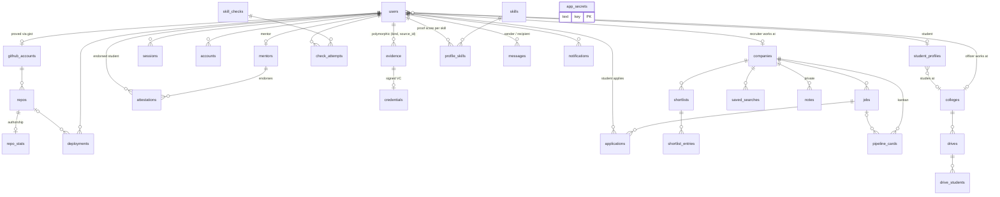

# Proof architecture

Read this before adding a feature. The product spec is `SPEC.md`; build state is `docs/STATUS.md`.

## Stack

| Concern | Choice |
|---|---|
| Framework | Next.js 16 App Router (Turbopack), React 19, TypeScript strict (`noUncheckedIndexedAccess`) |
| Styling | Tailwind CSS v4 (tokens in `src/app/globals.css`), Radix primitives via the `radix-ui` package, lucide icons |
| Motion | `motion/react` with presets in `src/components/motion/transitions.ts` |
| Data | Drizzle ORM. PGlite (`.data/pglite`) locally, Neon via `DATABASE_URL` in production |
| Auth | Better Auth (email + password), role stored on `users.role` |
| Validation | Zod 4 schemas in `src/lib/validation/` |

Next 16 notes: middleware is now `src/proxy.ts`; `params` / `searchParams` are Promises; check
`node_modules/next/dist/docs` when unsure.

## Folders

```
src/
  app/
    (public)/            landing "/", /u/[handle], /verify/[id]  (SiteHeader + SiteFooter)
    (auth)/              /login, /signup (split-screen layout)
    (portals)/
      student/           layout.tsx -> <PortalLayout portal="student">, page.tsx, [...slug] placeholder
      recruiter/  college/  mentor/   same shape
    api/auth/[...all]/   Better Auth handler
    api/notifications/stream/  SSE live notifications (session-scoped; polls, heartbeats, self-closes at 45 s)
    globals.css          design tokens (light paper + dark ink) and keyframes
  components/
    ui/                  the component kit (one component per file, no barrel)
    motion/              FadeIn, Stagger/StaggerItem, NumberTicker, MotionProvider, springs
    shell/               AppShell, sidebar nav config, ⌘K palette, bell, user menu, PortalLayout
    marketing/           landing-only pieces
    theme/               no-flash ThemeScript, ThemeProvider, ThemeToggle
    brand/               Logo
  db/
    schema.ts            the WHOLE data model + relations + exported types
    index.ts             getDb() / closeDb()
  lib/
    auth/roles.ts        roles, portals, PORTAL_ACCESS, homeFor()  (client + server safe)
    auth/client.ts       Better Auth React client (signIn, signUp, signOut, useSession)
    validation/          Zod schemas, one file per area (auth.ts exists)
    utils.ts             cn(), formatters
  server/
    auth/auth.ts         getAuth(): Better Auth instance (lazy, DB-backed secret)
    auth/guard.ts        requireRole / requireUser / assertRole / getCurrentUser   <- THE guard
    secrets.ts           getOrCreateSecret(): generated-once secrets in app_secrets
    demo/actions.ts      demoSignIn(): one-tap demo logins, only when NEXT_PUBLIC_DEMO_MODE=true (lib/demo.ts)
    email/               THE mail adapter: sendEmail(), Resend + on-screen fallback, rate limits, templates
    <area>/queries.ts    reads, scoped by role and ownership
    <area>/actions.ts    "use server" mutations (create when needed)
  proxy.ts               optimistic cookie check for portal routes
scripts/                 migrate.ts, seed.ts, seed-data.ts, reset.ts
drizzle/                 generated SQL migrations (commit them)
```

## Conventions (follow these exactly)

1. **Server code lives in `src/server/<area>/`.** Areas: `student`, `recruiter`, `college`,
   `mentor`, `public`, `notifications`, plus engine areas as they arrive (`verification`,
   `scoring`, `credentials`, `checks`, `search`). Reads go in `queries.ts`, mutations in
   `actions.ts` (`"use server"` at the top), shared helpers in other files. Every file starts with
   `import "server-only"` (except modules scripts must import: `src/db`, `src/server/secrets.ts`).
2. **Every query is scoped by role and ownership.** Take the identity from the session, never
   from the client: `const user = await requireRole("recruiter")` then filter by
   `user.companyId`; students by `user.id`; placement officers by `user.collegeId`. Never accept a
   `userId`/`companyId` argument from a form or URL without checking it against the session.
3. **One guard.** Pages and layouts call `requireRole(...)` (redirects). Server actions and route
   handlers call `assertRole(...)` (throws `AuthError` 401/403). Admin passes every role check.
   The proxy is only an optimistic cookie check. Portal access is defined once in
   `PORTAL_ACCESS` (`src/lib/auth/roles.ts`).
4. **Zod everywhere.** Each area gets `src/lib/validation/<area>.ts`. Parse in the action
   (`schema.safeParse(input)`) even when the form also validates on the client. Use
   `fieldErrors()` from `validation/auth.ts` to map issues to form fields.
5. **Database access only through `const db = await getDb()`.** Prefer the query builder and
   `db.query.<table>.findFirst/findMany({ with })`. Do not rely on `db.execute()` result shapes
   (they differ between PGlite and Neon).
6. **Schema changes:** edit `src/db/schema.ts`, run `npm run db:generate`, commit the new file in
   `drizzle/`. PGlite auto-applies pending migrations on first connection in dev; production runs
   `scripts/db-deploy.mjs` in `vercel-build` (migrate, then seed the demo only on an empty DB when
   `SEED_DEMO=true`). Never edit an applied migration.
7. **Pages that touch the DB are dynamic** (`export const dynamic = "force-dynamic"` or they read
   cookies). Never query the DB from a statically prerendered page: PGlite is single-process and
   `next build` runs several workers.
8. **UI:** compose from `src/components/ui/*`; use tokens (`bg-surface`, `text-muted`,
   `border-line`, `text-verified`, `bg-lime text-lime-ink`, `text-violet-text`,
   `text-coral-text`) instead of raw colours. Verified states always use lime + `SealGlyph` or
   `<Seal>`. Fonts: `font-display` (Bricolage Grotesque), default Inter, `font-mono` (JetBrains Mono).
   Motion: use `springs.*`, 150-400 ms; `MotionConfig reducedMotion="user"` is global.
9. **New portal page:** add `src/app/(portals)/<portal>/<page>/page.tsx` (it overrides the
   `[...slug]` placeholder), call `requireRole`, start with `<PageHeader>`, then register it in
   `src/components/shell/nav-config.ts` and remove `soon: true`.
10. **No typed secrets.** Need a key? `getOrCreateSecret("name", generate)` from
    `src/server/secrets.ts`. The Ed25519 credential keypair key name is reserved as
    `SECRET_KEYS.credentialKeypair`.

## Auth

- `getAuth()` builds Better Auth lazily: secret = `BETTER_AUTH_SECRET` or a 64-byte secret
  generated once into `app_secrets`. Better Auth tables are `users`, `sessions`, `accounts`,
  `verifications` (mapped in the drizzle adapter).
- `users.role` is chosen at sign-up (`student | recruiter | college | mentor`); `admin` is
  rejected by a `databaseHooks.user.create.before` hook and only seeded.
- Recruiters, colleges and mentors get `domain_verification = "pending"` (stub). The magic-link
  domain verification flow will flip it to `verified`, and set `companies/colleges.domain_verified_at`
  or `mentors.domain_verified_at`. Client input cannot set it (`input: false`).
- Students get a `student_profiles` row with a unique handle in the `create.after` hook.
- Sign-in is rate-limited by Better Auth in production (3 attempts per 10 s per IP).
- **Email verification:** the `emailOTP` plugin (`src/server/auth/email-otp.ts`) sends a 6-digit
  code on sign-up (`emailVerification.sendOnSignUp`). `requireRole` / `requireUser` redirect an
  unverified account to `/verify-email`; `assertRole` throws 403. Password reset is
  `/forgot-password` then `/reset-password` (emailOTP `forget-password`), with
  `revokeSessionsOnPasswordReset`. OTPs are stored hashed in `verifications`.
- **Email** only through `src/server/email` (`sendEmail`). It needs `RESEND_API_KEY` **and**
  `EMAIL_FROM` (env only, never hardcoded). Not configured, or the sender domain rejected: the
  code / link is recorded in `email_deliveries.reveal` and shown on screen in demo mode or
  development, otherwise the action returns a friendly error. Screens read the outcome with
  `verificationCodeStatus()` / `resetCodeStatus()` (`src/server/email/actions.ts`).

## Data model

All ids are `text`. Foreign keys to a student always point at `users.id`
(`student_profiles.user_id` is unique). Evidence is polymorphic by `(kind, source_id)`.



Key columns for upcoming builders:

- `student_profiles`: `handle`, `visibility` (public / recruiters / hidden), `proof_score`,
  `score_breakdown` (`ScoreBreakdown` JSON with `reasons[]` for the "why 82?" drawer),
  `search_text` (GIN `to_tsvector` index for full-text recruiter search), `pinned_evidence_ids`.
- `github_accounts`: `nonce`, `gist_id`, `etag`, `status`. `repos`/`repo_stats`: authorship
  facts and `red_flags[]`. `deployments`: `token`, `method` (meta / well_known), health fields.
- `skill_checks.hidden_tests` must never reach the client. `check_attempts` stores score,
  timing, `paste_events`, `tab_blurs`.
- `evidence.skill_slugs[]`, `weight`, `data` (snapshot at verification time).
- `credentials.vc` holds the complete signed VC JSON; `key_id` names the platform key.
- `pipeline_cards.position` is a sparse float (insert between neighbours without renumbering).

## Database lifecycle

| Command | What it does |
|---|---|
| `npm run db:generate` | SQL migration from schema changes into `drizzle/` |
| `npm run db:migrate` | Apply migrations (PGlite or `DATABASE_URL`) |
| `npm run db:seed` | Wipe + seed fictional demo data (refuses remote unless `PROOF_SEED_REMOTE=1`) |
| `npm run db:reset` | Delete `.data/pglite`, migrate, seed |

PGlite is single-process: stop `npm run dev` / `npm start` before running migrate or seed.

## Ports

Dev and `start`: **5190**. Tests (Playwright): **5191**. Never 3000 or 4576.
