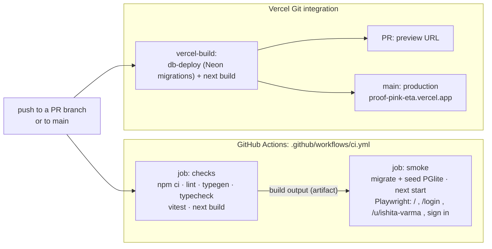

# CI/CD for Proof: a practical guide

This guide explains the automation that checks and ships Proof, using the real files in this
repo. Read it top to bottom once, then do the five exercises at the end: breaking things on
purpose is the fastest way to learn how a pipeline behaves.

Files this guide talks about:

| File | What it is |
|---|---|
| [`.github/workflows/ci.yml`](../.github/workflows/ci.yml) | The CI pipeline (GitHub Actions) |
| [`.github/e2e/playwright.config.mjs`](../.github/e2e/playwright.config.mjs) | How the browser smoke test starts the app |
| [`.github/e2e/smoke.spec.mjs`](../.github/e2e/smoke.spec.mjs) | The smoke test itself (4 checks) |
| [`.github/dependabot.yml`](../.github/dependabot.yml) | Automatic dependency-update pull requests |
| [`.github/pull_request_template.md`](../.github/pull_request_template.md) | The checklist every new pull request starts with |
| [`vercel.json`](../vercel.json) + `vercel-build` in `package.json` | How Vercel builds and deploys |

---

## 1. What CI and CD mean

**Continuous Integration (CI)** means: every time someone pushes code, a machine that is not your
laptop checks it out from scratch and runs the same checks, the same way, every time. If any check
fails, the change is marked red before it can reach `main`. It catches the "works on my machine"
problems: a file you forgot to commit, a type error in a file you did not open, a test you did not
run, a dependency that only exists in your `node_modules`.

**Continuous Delivery / Deployment (CD)** means: once code is on `main` (or in a pull request), it
is deployed automatically, with no one running deploy commands by hand. *Delivery* usually means
"always ready to deploy"; *deployment* means "actually deployed on every merge". Proof does
continuous deployment: merging to `main` updates the live site.

The two together give you a loop:

```
write code -> push a branch -> open a pull request
   -> CI checks it            (GitHub Actions: is it correct?)
   -> Vercel builds a preview (Vercel: what does it look like?)
   -> review + merge to main
   -> CI checks main again, Vercel deploys production
```

---

## 2. The pipeline in this repo



If the diagram does not render where you are reading this, here is the same thing in text:

```
                 +-------------------- GitHub Actions (CI) ---------------------+
 git push  --->  |  checks: install -> lint -> typecheck -> unit tests -> build  |
     |           |                                  |  (build output artifact)   |
     |           |  smoke:  install -> seed PGlite -> next start -> Playwright   |
     |           +---------------------------------------------------------------+
     |
     +------->   Vercel (CD): pull request -> preview URL;  main -> production
```

GitHub Actions and Vercel run **in parallel and independently**. Vercel does not wait for CI. That
is why branch protection (section 5) matters: it is what stops a red pull request from being merged,
and merging is what triggers the production deploy.

### When does it run?

- `pull_request`: every push to any pull request (new commits re-run it).
- `push` to `main`: after every merge, so `main` itself is always checked.
- `workflow_dispatch`: a manual **Run workflow** button on the Actions tab.

A newer push to the same pull request cancels the older, still-running run (`concurrency` with
`cancel-in-progress`), so you do not wait for results nobody needs.

---

## 3. What each job does, and why

### Job 1: `checks` (about 3 to 5 minutes)

| Step | Command | Why it is there |
|---|---|---|
| Check out the code | `actions/checkout` | The runner is a brand-new Ubuntu VM with nothing on it. |
| Set up Node.js 22 | `actions/setup-node` with `cache: npm` | Same Node major as Vercel. `cache: npm` keeps npm's download cache between runs, so installs are faster. |
| Install | `npm ci` | Installs **exactly** what `package-lock.json` says, and fails if `package.json` and the lockfile disagree. `npm install` would quietly change the lockfile instead. |
| Lint | `npm run lint` | ESLint with the Next.js rules: catches bugs like missing hook dependencies and unused variables. |
| Generate types | `npx next typegen` | `next-env.d.ts` is gitignored, so a fresh checkout does not have it. This generates it (and route types) without a full build. |
| Typecheck | `npm run typecheck` | `tsc --noEmit` over the whole project, including files nobody opened this week. |
| Unit tests | `npm test` | Vitest runs the engine tests in `src/**/*.test.ts` (scoring, credentials, search, verification, sandbox). Fast, no database. |
| Build cache | `actions/cache` on `.next/cache` | Lets Next.js reuse work from the previous build. |
| Build | `npm run build` | `next build`: the same compile Vercel does. A page that fails to build fails here first. |
| Upload build | `actions/upload-artifact` | Hands the compiled `.next` folder to the smoke job, so the smoke test runs the **exact** build that just passed, not a rebuild. Kept for 1 day. |

The steps run in order and stop at the first failure. Cheap, fast checks go first so you hear about
a lint error in 30 seconds instead of after a 3-minute build.

### Job 2: `smoke` (about 3 to 4 minutes, starts only if `checks` passed)

Unit tests prove the engines are right. They do not prove the app *starts*, that pages render, or
that signing in works end to end. That is what a **smoke test** is for: "switch it on and see
whether smoke comes out". It is deliberately small.

| Step | Why |
|---|---|
| `npm ci` | Separate job means separate, clean VM. |
| Make sure Playwright is installed | Uses the locked version; installs a pinned one without editing `package.json` if it is missing. |
| `npx playwright install --with-deps chromium` | Downloads Chromium plus the Linux libraries it needs. Only Chromium, to keep it fast. |
| Download the build | The artifact from job 1, unpacked back into `.next`. |
| `npm run db:migrate` then `npm run db:seed` | No `DATABASE_URL` is set, so Proof uses **PGlite** (Postgres compiled to WebAssembly, stored in `.data/pglite`). No database server, no secret. The seed creates the fictional demo accounts. |
| `npx playwright test --config .github/e2e/playwright.config.mjs` | Starts `next start -p 5191` and runs the four checks below in headless Chromium. |
| Upload the Playwright report (only on failure) | The HTML report, screenshots and traces, so you can see what the browser saw. Kept for 14 days. |

The four smoke checks (`.github/e2e/smoke.spec.mjs`):

1. `/` returns 200 and the page title contains "Proof".
2. `/login` returns 200 and shows the "Welcome back" heading and both inputs.
3. `/u/ishita-varma` (a public student profile from the seed) returns 200 and shows "Ishita Varma".
4. The demo student `ishita@spit-surat.example` can sign in and lands on `/student`.

Test 4 is the most valuable one: it exercises the browser, the React form, Better Auth, the
database, the session cookie and the role redirect in a single flow.

### Why two jobs instead of one?

- The smoke job needs Chromium (a big download). No point downloading it if lint already failed.
- In the pull request's checks list you see *which* layer broke: code quality, or the running app.
- It shows a real pattern: **build once, test that same artifact**, then deploy.

### Security settings worth noticing

- `permissions: contents: read`: the workflow's automatic `GITHUB_TOKEN` can read the code and
  nothing else. It cannot push, comment, or change settings, even if a dependency were malicious.
- `timeout-minutes` on each job: a stuck job is killed after 20 minutes instead of burning minutes
  for up to 6 hours.

---

## 4. How preview deployments work (the CD half)

Vercel is connected to the GitHub repo through its **Git integration**, so there is no deploy job
in `ci.yml` and no Vercel token anywhere in GitHub.

- **Every pull request** gets its own *preview deployment* with a unique URL. The Vercel bot
  comments the link on the pull request, and it updates on every push. Reviewers click the link
  instead of running the branch locally.
- **Every push to `main`** (that is, every merge) becomes a *production deployment* at
  https://proof-pink-eta.vercel.app.
- Vercel runs the `vercel-build` script from `package.json`: `scripts/db-deploy.mjs` (applies
  `drizzle/` migrations to Neon and seeds the demo once, when the database is empty) and then
  `next build`.
- A bad production deploy is undone in seconds: Vercel dashboard -> **Deployments** -> pick the
  last good one -> **Promote to Production** (or **Instant Rollback**).

**Know this about previews and the database.** A preview build runs `db-deploy.mjs` too, against
whatever `DATABASE_URL` Vercel gives the **Preview** environment. Look at Vercel -> Project ->
Settings -> Environment Variables:

- If `DATABASE_URL` is not set for Preview, preview builds stop with "DATABASE_URL is not set for
  this Vercel build".
- If Preview uses the **same** Neon database as Production, a pull request that adds a migration
  migrates the production database when its preview builds, before anyone merges. The safe setup is
  the Neon integration's per-preview database branch (each preview gets its own copy). Check this
  before the first pull request that touches `drizzle/`.

If a reviewer opening a preview link sees a Vercel login page, that is Vercel's *Deployment
Protection* (Settings -> Deployment Protection). It is on purpose: previews are private by default.

---

## 5. Make CI a required check (branch protection)

Without this, CI only *informs*: a red pull request can still be merged, and the merge deploys to
production. With it, GitHub greys out the merge button until CI is green.

The check names only exist after the workflow has run once, so first open any pull request and let
CI finish. Then:

1. On GitHub, open the repo -> **Settings** -> **Rules** -> **Rulesets** -> **New ruleset** ->
   **New branch ruleset**.
2. **Ruleset name**: `protect main`. **Enforcement status**: **Active**.
3. **Target branches** -> **Add target** -> **Include default branch**.
4. Tick **Require a pull request before merging**. (Required approvals can stay at 0 while you
   work solo; raise it to 1 when someone else reviews.)
5. Tick **Require status checks to pass** -> **Add checks** -> type and add both:
   `Lint, typecheck, unit tests, build` and `Playwright smoke test`.
   Also tick **Require branches to be up to date before merging**.
6. Tick **Block force pushes**. Leave **Restrict deletions** ticked.
7. **Create**.

The older screen does the same thing: **Settings** -> **Branches** -> **Add classic branch
protection rule** -> pattern `main` -> **Require status checks to pass before merging** -> search
for the two checks.

From now on, changes reach `main` only through a pull request with green CI. That includes yours,
which is the point: it is the habit, not distrust.

---

## 6. Reading a failed run, and re-running it

**Find it.** On the pull request, the checks box at the bottom shows a red X next to the failing
job. Click **Details**. (Or: repo -> **Actions** tab -> the run.)

**Read it.**

1. The left sidebar lists the jobs; the red one failed. Inside it, the red step is where it
   stopped. Steps after it show as skipped, and if `checks` failed, `smoke` never started.
2. Expand the red step and scroll to the **first** error, not the last line. The last lines are
   usually just "Process completed with exit code 1".
3. The **Summary** page shows annotations: lint and typecheck errors and Playwright failures are
   linked to the file and line.
4. For `smoke` failures: scroll to **Artifacts** at the bottom of the Summary page and download
   `playwright-report`. Unzip it and open `playwright-report/index.html`. Each failed test has a
   screenshot, an error with the expected vs received value, and a **trace**: open it at
   https://trace.playwright.dev (it runs in your browser; nothing is uploaded) to step through every
   click with the DOM and network at that moment.

**Reproduce it locally.** CI runs plain npm scripts, so the fix loop is on your laptop:

```bash
npm ci
npm run lint
npx next typegen && npm run typecheck
npm test
npm run build

# the smoke test (stop `npm run dev` first: PGlite is single-process)
npm run db:migrate && npm run db:seed
npx playwright install chromium        # once
npx playwright test --config .github/e2e/playwright.config.mjs
npx playwright show-report             # open the HTML report
```

To run the smoke test against a server that is already up instead of starting one:
`PROOF_BASE_URL=http://localhost:5190 npx playwright test --config .github/e2e/playwright.config.mjs`.

**Re-run it.**

- Push a fix to the same branch: CI runs again automatically.
- Failure looks random (a network blip, a slow download)? On the run page, **Re-run jobs** ->
  **Re-run failed jobs**. Only use this when you believe nothing in the code caused it. If a test
  fails, passes on re-run, then fails again, it is *flaky*, and a flaky test is a bug to fix, not
  to keep re-running.
- **Re-run jobs** -> **Enable debug logging** gives far more detail when a step fails mysteriously.
- **Actions** -> **CI** -> **Run workflow** starts a fresh run on any branch.

---

## 7. Secrets in GitHub Actions (and why this setup needs none)

A **secret** is an encrypted value (an API key, a token, a password) stored at repo -> **Settings**
-> **Secrets and variables** -> **Actions**. A workflow reads one as `${{ secrets.NAME }}`.

- GitHub masks secret values in logs (they print as `***`).
- Secrets are **not** given to workflows triggered by pull requests from **forks**. Otherwise anyone
  could open a pull request that prints your keys. Your own branches do get them.
- Every run also gets an automatic, short-lived `GITHUB_TOKEN`. Its powers are set by the
  `permissions:` block. Ours is `contents: read`, the minimum.
- **Variables** (same settings page) are for non-secret configuration and are not masked.
- Never commit a secret to the repo, not even "temporarily": git history keeps it forever. If it
  happens, rotate the key; deleting the commit is not enough.

**Why Proof's CI needs no secrets at all:**

- **Database**: CI uses PGlite, an in-process Postgres that lives in a folder. There is no database
  server to log in to.
- **Auth**: Better Auth generates its own secret on first start and stores it in that database.
- **Test login**: the demo accounts are fictional seed data with a published password.
- **Deploys**: Vercel's Git integration deploys on its own. GitHub never holds a Vercel token.

Fewer secrets means less to leak, nothing to rotate, and CI that also works on forks. If you ever
add one (say a `GITHUB_TOKEN` for the verification engine's rate limits), add it under Settings ->
Secrets and pass it to one step with `env:`, not to the whole workflow.

---

## 8. Free-tier limits

**GitHub Actions**

- This repo is **public**, so GitHub-hosted runners (`ubuntu-latest`) are **free with no minute
  limit**.
- For comparison, a private repo on the Free plan gets 2,000 minutes a month and 500 MB of artifact
  storage. Each run of this pipeline uses roughly 6 to 10 runner minutes across both jobs.
- Limits that still apply: a job can run for at most 6 hours, about 20 jobs at once on the Free
  plan, and 10 GB of `actions/cache` per repo (old entries are evicted automatically).
- Artifacts: the build artifact is kept 1 day and the Playwright report 14 days, so storage stays
  tiny.

**Vercel Hobby (free)**

- For **personal, non-commercial** projects. A team or commercial product needs Pro.
- Unlimited preview deployments within the plan's caps, including a daily deployment cap (100 per
  day at the time of writing) and one build at a time (a second push waits in the queue).
- Monthly caps on bandwidth and function usage. The current numbers are on
  https://vercel.com/docs/limits; the Usage tab in the dashboard shows where you stand.

**Neon (the production database)**: the free plan has storage and compute-hour caps, and the
database suspends when idle, so the first request after a quiet period is slower.

**Dependabot**: free for public and private repos.

---

## 9. Dependabot and the pull request template

**Dependabot** (`.github/dependabot.yml`) checks for updates and opens pull requests for you:

- **npm, weekly on Monday.** Minor and patch updates arrive as **one** grouped pull request; major
  updates as a second group, because majors are the ones that break things. At most 5 open at once.
- **GitHub Actions, monthly.** Bumps `actions/checkout`, `actions/setup-node` and the others in
  `ci.yml`.

Each Dependabot pull request runs CI like any other. That is the payoff of having CI: a green
dependency update is usually safe to merge after a look at the changelog and the preview; a red one
tells you exactly what broke.

**The pull request template** (`.github/pull_request_template.md`) pre-fills every new pull request
with a short description, how-to-check steps and a checklist (CI green, preview checked, tests,
migrations, no secrets).

---

## 10. Five exercises

Do them in order, each on its own branch. Every one ends by closing the pull request **without
merging** and deleting the branch.

### Exercise 1: watch a green run

1. `git switch -c learn/ci-hello`, change a word in `README.md`, commit, push, open a pull request.
2. On the pull request, watch the checks appear. Click **Details** on each job and expand the steps.
3. Find the Vercel bot's comment and open the preview URL.

Question to answer: how long did each job take, and which step was the slowest?

### Exercise 2: break a unit test

1. `git switch -c learn/break-test` from `main`.
2. Open `src/server/scoring/engine.test.ts` and change one expected number in an `expect(...)`.
3. Run `npm test` locally first and read the failure. Then push and open a pull request.
4. In the CI log, find the same failure. Notice that `smoke` never started.
5. Undo the change, push again, and watch it turn green.

### Exercise 3: break the smoke test, then read the report

1. `git switch -c learn/break-smoke` from `main`.
2. In `src/app/(auth)/login/login-form.tsx`, change the heading text `Welcome back` to
   `Welcome`.
3. Push and open a pull request. `checks` passes (it is valid code) but `smoke` fails: this is the
   kind of bug only an end-to-end test catches.
4. Download the `playwright-report` artifact, open `index.html`, look at the screenshot, then open
   the trace at https://trace.playwright.dev.

### Exercise 4: turn on branch protection and try to merge red

1. Follow section 5 to create the ruleset.
2. Push a type error to a new branch, for example `const n: number = "nope";` in any `.ts` file
   under `src/`, and open a pull request.
3. Confirm the merge button is blocked, and read which check is required.
4. Close the pull request without merging.

### Exercise 5: add your own smoke check

1. `git switch -c learn/my-smoke-check` from `main`.
2. Add a fifth test to `.github/e2e/smoke.spec.mjs`, for example that `/pricing` returns 200 and
   shows a heading. Copy the shape of `"login page renders"`.
3. Run it locally (section 6), then push and watch CI run five tests.
4. Bonus: add a test that a **wrong** password stays on `/login` and shows an error message.
   (Here you can keep the pull request and merge it: it is a real improvement.)

---

## Cheat sheet

| I want to... | Do this |
|---|---|
| See why CI failed | Pull request -> red check -> **Details** -> first red step -> first error |
| See what the browser saw | Run **Summary** -> **Artifacts** -> `playwright-report` -> `index.html` |
| Re-run a random failure | Run page -> **Re-run jobs** -> **Re-run failed jobs** |
| Run CI by hand | **Actions** -> **CI** -> **Run workflow** |
| Run everything locally | `npm ci && npm run lint && npx next typegen && npm run typecheck && npm test && npm run build` |
| Roll back production | Vercel -> **Deployments** -> last good one -> **Promote to Production** |
| Block red merges | Section 5 (ruleset on `main` requiring both checks) |
